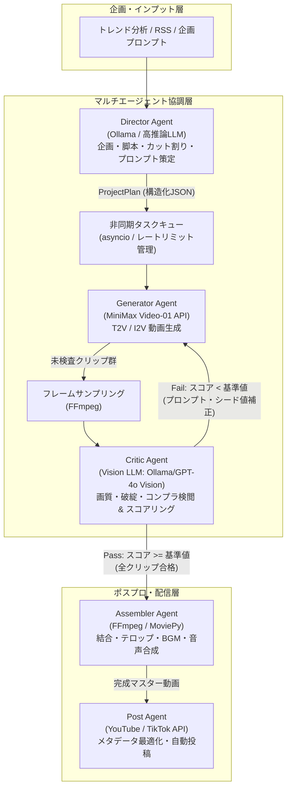

# CreateStudio システムアーキテクチャ解説

## 1. 全体像と設計思想

CreateStudioは、人間が毎回手動でプロンプトを入力して試行錯誤するのではなく、**LLM・マルチモーダルVision・動画生成API・外部メディア処理ツールを統合した自律型マルチエージェントパイプライン**によって、企画から動画生成、自己修復ループ、編集、投稿準備までを完全に自動化することを目的としています。

---

## 2. コアエージェントの責務分離

| エージェント | 主な責務 | 入力 | 出力 | 主要技術 |
| :--- | :--- | :--- | :--- | :--- |
| **Director Agent** | 企画立案、脚本作成、カット割り、カメラワーク・演出策定 | トレンド情報、テーマ | `ProjectPlan` (JSON) | Ollama (Llama 3.1等), Pydantic |
| **Generator Agent** | 動画生成タスク発行、非同期ポーリング、レート制限管理 | `CutPlan` | MP4クリップ | MiniMax Video-01 API, httpx |
| **Critic Agent** | フレーム抽出、解剖学的破綻/指示遵守度の採点、自己修復ループ | MP4クリップ, 演出意図 | `CutEvaluation` (Pass/Retry) | Ollama (LLaVA/Llama-Vision), FFmpeg |
| **Assembler Agent** | クリップ結合、BGM（ダッキング）、テロップ合成、エンコード | 合格クリップ群, 音声, 字幕 | 完成動画 (9:16 Shorts等) | FFmpeg, MoviePy |
| **Post Agent** | タイトル・概要文最適化、タグ選定、プラットフォーム予約投稿 | 完成動画, 企画情報 | 投稿完了ログ, 公開URL | YouTube Data API, TikTok API |

---

## 3. 自己修復ループ（Self-Healing Critique Loop）

本アーキテクチャの最大の特徴は、**Critic Agent による自己修復ループ**です。
1. Generator Agentが生成したクリップから代表フレーム（冒頭・中央・終盤）を抽出。
2. Vision LLMが「顔の歪み」「テクスチャの破綻」「指・身体の異常」「アクション達成度」を1〜10点でスコアリング。
3. 基準点（例: 各項目7点以上、総合8点以上）を下回った場合、Critic Agentが不合格原因を分析し、ネガティブプロンプトの追加やシード値の変更、プロンプトの微調整を自動生成。
4. Generator Agentが修正指示を受け取り、再生成を実行（最大リトライ回数: 2〜3回）。
5. 規定回数内に合格しないクリップがある場合のみ、人間にエスカレーションまたはフォールバック策を適用。

---

## 4. 関連ドキュメント
* 👉 **[自律生成パイプライン確定仕様 (Doc/Spec/content_pipeline.md)](./Spec/content_pipeline.md)**
* 👉 **[意思決定記録: MiniMax＋Ollamaハイブリッド構成 (Doc/Wiki/ADR/ADR-002)](./Wiki/ADR/ADR-002_minimax_and_ollama_hybrid.md)**
* 👉 **[開発進捗ダッシュボード (Doc/Plan/index.md)](./Plan/index.md)**
