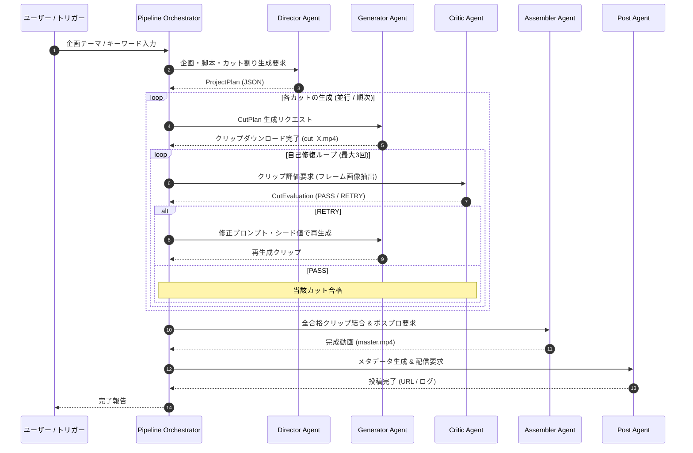

# 自律型動画生成パイプライン仕様 (Content Pipeline Spec)

## 1. 概要
本仕様は、企画テーマの入力から各エージェント（Director, Generator, Critic, Assembler, Post）が協調して1本の動画を完成させるパイプラインの動作仕様を定めます。

---

## 2. 実行シーケンス

---

## 3. エラーハンドリング & フォールバック
1. **リトライ上限到達**:
   - 3回リトライしても Critic Agent の基準点（8.0点以上）に達しないカットがある場合、最高スコアのクリップを採用するか、人間への通知フラグ（`NeedsReview`）を付与してパイプラインを一時停止する。
2. **APIレートリミット到達 (HTTP 429)**:
   - 指数バックオフ（初期5秒、最大60秒）で自動待機・再試行。
3. **ディスク空き容量チェック**:
   - 生成開始前に `temp/` および `output/` に最低2GBの空き容量があるか検証。
