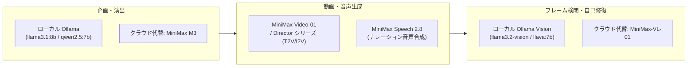

# MiniMax API モデル体系・種類比較資料

## 1. 概要
MiniMax社（Hailuo AI）が提供する基盤モデル群（動画・テキスト・音声・マルチモーダル）の網羅的比較および本プロジェクト（CreateStudio）における活用マップです。

---

## 2. カテゴリ別モデル一覧 & スペック比較

### ① 動画生成モデル (Video Generation / Hailuo AI)
動画生成パイプラインの心臓部となるモデル群です。

| モデル名 | 主要スペック | 特徴・強み | CreateStudioでの役割 |
| :--- | :--- | :--- | :--- |
| **`video-01`** | 720p / 25fps / ~6秒 / T2V, I2V | 映画品質のシネマティック映像。カメラワーク追従性が高く物理挙動が安定。 | **標準クリップ生成 (Generator Agent)** |
| **`T2V-01-Director`** | 720p / 25fps / T2V | カメラ動作（Pan, Tilt, Zoom）のプリセット制御が可能でランダム性を抑制。 | **精密カメラ制御が必要なカット** |
| **`I2V-01-Director`** | 720p / 25fps / I2V | 参照画像（キャラアセット等）からの一貫した動画化・シーン展開。 | **キャラクター同一性維持カット** |
| **`H3`** | 最新世代マルチモーダル動画モデル | より高精細な表現力と高度なプロンプト解釈力を備えた次世代モデル。 | 将来のアップグレード候補 |

---

### ② 音声合成・ボイスモデル (Speech / TTS)
ナレーションやキャラクターボイス生成に特化したモデル群です。

| モデル名 | 主要スペック | 特徴・強み | CreateStudioでの役割 |
| :--- | :--- | :--- | :--- |
| **`Speech-01`** | 多言語、感情指定、ボイスクローン | わずか10秒の参照音声から高精度な声質クローニングが可能。喜怒哀楽の表現に対応。 | **キャラクター音声・多言語展開** |
| **`Speech 2.8`** | スタジオ品質、高サンプリングレート | 最新世代のTTS。オーディオブックやドキュメンタリー調の滑らかで自然な発話。 | **メインナレーション (Assembler)** |

---

### ③ 言語モデル (Large Language Models / Text)
企画立案、脚本作成、構造化JSON出力を担うモデル群です。

| モデル名 | コンテキスト長 | アーキテクチャ / 特徴 | CreateStudioでの役割 |
| :--- | :--- | :--- | :--- |
| **`MiniMax-Text-01`** | **400万トークン (4M)** | オープンウェイトMoEモデル。Lightning Attentionによる超長文処理と高速推論。 | 大量トレンド・長編脚本の統合分析 |
| **`MiniMax M3`** | **100万トークン (1M)** | 最新フラッグシップ。自律エージェントの推論、複雑なコーディング、ツール利用に最適。 | クラウド版Director Agent代替 |
| **`abab 6.5s` / `abab 6.5`** | 200k トークン | 初代MoE主力モデル。高速かつ高コストパフォーマンス。 | 従来のバッチ要約処理 |

---

### ④ マルチモーダルVisionモデル (Multimodal / Vision)
画像理解・フレーム検閲に特化したモデル群です。

| モデル名 | 主要機能 | 特徴 | CreateStudioでの役割 |
| :--- | :--- | :--- | :--- |
| **`MiniMax-VL-01`** | 画像＋テキスト入力、視覚推論 | 高解像度画像のOCR、オブジェクト配置、不自然さの検出に対応。 | クラウド版Critic Agent（予備検証） |

---

## 3. CreateStudio における最適モデル採用マトリクス

