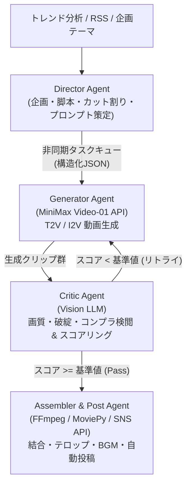

# CreateStudio

Ollama（ローカルLLM/Vision）＋MiniMax（動画生成API）とAntigravityを融合した、マルチエージェント型自律コンテンツ生成スタジオです。  
企画から脚本策定、カット割り、動画・音声生成、品質検閲・自己修復ループ、編集・テロップ合成、SNS投稿までを自動化します。

---

## アーキテクチャ概要



### コアエージェントの役割
- **Director Agent**: トレンドや指定テーマから脚本を生成し、カットごとのT2Vプロンプト、カメラワーク、ナレーション、テロップを構造化JSONとして策定。
- **Generator Agent**: MiniMax Video-01 API等のエンドポイントを非同期呼び出し。レートリミットを考慮したタスクキュー管理とポーリング。
- **Critic Agent**: サンプリングした動画フレームをVision LLMに入力し、「顔の歪み」「テクスチャ破綻」「アクション達成度」「安全性」を採点。不合格時はプロンプト等を自己補正してリトライ。
- **Assembler & Post Agent**: 合格したクリップ群をFFmpeg等で結合し、ナレーションやBGM（ダッキング処理）、動的テロップを合成してYouTube ShortsやTikTokへ投稿。

---

## ディレクトリ構成

```
CreateStudio/
├── .agent/              # サブモジュール (agent-core: Projects/CreateStudio)
│   ├── skills/          # 最適化スキル群 (director, generator, critic, assembler, post等)
│   └── workflows/       # 自律生成パイプライン定義
├── src/
│   ├── core/            # Pydanticモデル, 設定定義
│   ├── agents/          # Director, Generator, Critic, Assembler 実装
│   ├── pipeline/        # オーケストレーター・キュー制御
│   └── utils/           # FFmpegラッパー, ロギング
├── assets/              # BGM, フォント, テンプレート
├── output/              # 生成動画・ログ出力先
├── tests/               # ユニットテスト
├── .env.example         # 環境変数テンプレート
├── .gitignore
├── requirements.txt
└── README.md
```

---

## クイックスタート

### 1. 依存ライブラリのインストール
```bash
pip install -r requirements.txt
```

### 2. 環境変数の設定
`.env.example` をコピーして `.env` を作成し、必要なAPIキーを設定してください。
```bash
cp .env.example .env
```

### 3. スキルとワークフロー
本プロジェクトでは `.agent/workflows/content_generation_pipeline.md` に従い、自律パイプラインを実行します。
